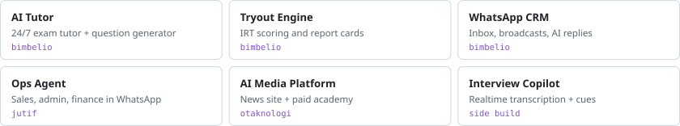

<code>strategy &amp; operations · ai agents &amp; automation</code>

## I run the business and build the AI that runs it.

ex-GoTo Financial, OJK · FEB UI · Jakarta

<picture>
  <source media="(prefers-color-scheme: dark)" srcset="assets/impact-dark.svg">
  
</picture>

### Built

<picture>
  <source media="(prefers-color-scheme: dark)" srcset="assets/builds-dark.svg">
  
</picture>

### By the numbers

<picture>
  <source media="(prefers-color-scheme: dark)" srcset="assets/numbers-dark.svg">
  
</picture>

<picture>
  <source media="(prefers-color-scheme: dark)" srcset="assets/commits-dark.svg">
  
</picture>

<picture>
  <source media="(prefers-color-scheme: dark)" srcset="assets/languages-dark.svg">
  
</picture>
<picture>
  <source media="(prefers-color-scheme: dark)" srcset="assets/hours-dark.svg">
  
</picture>

One-time snapshot, Nov 2025 – Nov 2026, from GitHub and git history via <a href="scripts/snapshot.py">scripts/snapshot.py</a>. Aggregates only; product code stays private.
