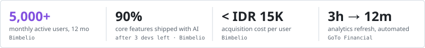
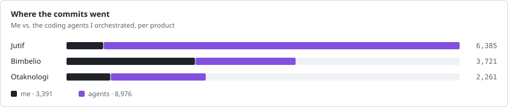
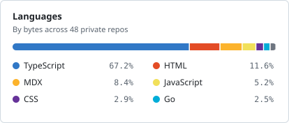
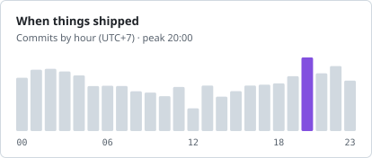

<code>// ai engineer · strategy &amp; operations background · ex-GoTo Financial, OJK</code>

## I build AI systems that run real businesses: tutors, CRMs, chatbots, and ops agents.

AI engineer with a strategy and operations background. I start from the business problem (a support queue, a sales pipeline, students who need a tutor at 2 a.m.), then design and ship the AI system that solves it, end to end. I work model-agnostic across OpenAI, Gemini, Claude, and open models, and I build with a fleet of coding agents, so one person ships like a small team.

Open to AI engineering, AI product, and business analysis roles. Hybrid, on-site, or remote.

### Impact

<picture>
  <source media="(prefers-color-scheme: dark)" srcset="assets/impact-dark.svg">
  
</picture>

### What I've built

**Bimbelio** · AI exam-prep platform for Indonesian university entrance · *AI Engineer*
- **BimBot AI tutor**: 24/7 tutoring for students, plus AI generation of exam questions.
- **IRT tryout engine**: computer-based tryouts scored with Item Response Theory, with score analytics and report cards.
- **AI WhatsApp CRM**: multi-account inbox, contact management, broadcasts, scheduling, AI-assisted auto-replies, and engagement analytics.
- **Support and community bots** on WhatsApp, Telegram, and Discord.

**Jutif** · digital studio for SMEs · *AI Engineer*
- **Hermes ops agent**: a WhatsApp assistant with four roles. Sales finds and audits prospects, Project Manager tracks deadlines, Admin drafts invoices and contracts, Finance turns receipt photos into books. It answers questions from company docs and cites its sources.
- **Brand engine and client websites** built on Next.js and Go.

**Otaknologi** · AI literacy media for Indonesian audiences · *AI Engineer*
- **Media and academy platform**: daily AI news site, paid courses, a Go API, and an admin publishing flow.
- **Agent-run content pipeline**: from research to scheduled posts across social channels.

**Side builds**
- **Interviewee**: macOS interview copilot with realtime transcription and answer cues, OpenAI with Gemini fallback.
- **Career-Ops**: agent-run job search, from finding roles to tailored CVs and outreach.
- **Usage bars**: native macOS menu bar apps that track AI usage across OpenCode, Codex, Claude Code, Ollama, and Qwen.

### By the numbers

<picture>
  <source media="(prefers-color-scheme: dark)" srcset="assets/numbers-dark.svg">
  
</picture>

<picture>
  <source media="(prefers-color-scheme: dark)" srcset="assets/commits-dark.svg">
  
</picture>

<picture>
  <source media="(prefers-color-scheme: dark)" srcset="assets/languages-dark.svg">
  
</picture>
<picture>
  <source media="(prefers-color-scheme: dark)" srcset="assets/hours-dark.svg">
  
</picture>

### Toolbox

**Languages** `TypeScript` `Python` `SQL` `Go` `Swift` `R` 
**AI** `OpenAI` `Gemini` `Claude` `Ollama` `Realtime speech` `Agent frameworks` 
**Product** `Next.js` `NestJS` `Postgres` `WhatsApp API` `Midtrans` `GitHub Actions` 
**Coding agents** `Codex` `OpenCode` `Claude Code`

Stats are a one-time snapshot (Nov 2025 – Nov 2026) generated by <a href="scripts/snapshot.py">scripts/snapshot.py</a> from GitHub and git history. Only aggregate numbers are published; all product code stays private.
